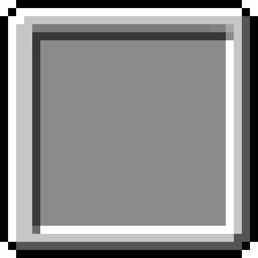

<!-- PROJECT BADGES -->
<div align="center">

![Version][version-badge]
[![Stars][stars-badge]][stars-url]
[![License][license-badge]][license-url]

</div>


<!-- PROJECT LOGO -->
<br />
<div align="center">
  
  <h3>UnicodeFontLoader</h3>
  <p align="center">
    A plugin that automatically loads unicode font images and packs them into a resource pack! (axolotl-pm/PocketMine-MP 5.x)

[Contact to me][author-discord] · [Report a bug][issues-url] · [Request a feature][issues-url]

  </p>
</div>


<!-- ABOUT THE PROJECT -->

### Overview

Ever felt bothered managing emoji fonts for the server?
Or struggled finding emoji Unicode?
Try this plugin!

This plugin automatically bundles font files located in the `resource_packs/fonts` directory into a resourcepack.

> For detailed information about image fonts, please
> visit [bedrock.dev/concepts/emojis](https://wiki.bedrock.dev/concepts/emojis.html)

- Automatically generates font resource pack based on character images (like `resource_packs/fonts/glyph_XX/YY.png`).
- Registers the generated resource pack on the server (with [resourcepack-register](https://packagist.org/packages/presentkim/resourcepack-register)).
- Separates and applies existing font glyph files (`glyph_**.png`) on `resource_packs/` directory.
- All results are cached to optimize repetitive tasks.
- No commands, permissions or configuration.

### Usage

1. When you apply the plugin and start the server, the default unicode font images are generated as examples in
   the `resource_packs/fonts` directory.
2. If a file named `resource_packs/fonts/glyph_XX/YY.png` exists, it will automatically be applied as the font corresponding to
   Unicode `U+XXYY`.
3. If you want to convert existing font files to fit the plugin, simply place the `glyph_XX.png` file in the `fonts`
   directory, and it will be automatically converted.

The automatic conversion and build feature runs once when the server starts up.
Restart is required for the changes to take effect after modification.

When using this image font on the server, simply input the corresponding character for 'U+XXYY' as usual.  
The Unicode converter can be conveniently accessed
via [bedrock.dev](https://wiki.bedrock.dev/concepts/emojis.html#hexValue)
or [unicodeconverter.net](https://unicodeconverter.net/).

> example) When server directory is configured as below,
>
> ```bash
> . # server directory
> ├── resource_packs
> │   └── fonts
> |       ├── glyph_E0
> |       |   ├──── 01.png
> |       |   ├──── 0A.png
> |       |   └──── ...
> |       |
> │       └──── glyph_E3.png
> │
> └── ...
> ```

---

### Installation & Requirements

- **Server**
  - [axolotl-pm/PocketMine-MP](https://github.com/axolotl-pm/PocketMine-MP) `5.51` or higher (`plugin.yml` `api: [5.51.0]`),
    which uses BedrockProtocol 64 (Bedrock `1.26.60`).
  - PHP `8.4` or higher.
  - PHP extensions `gd` and `zip`.
- **Installation**
  - Download `UnicodeFontLoader.phar` from [GitHub Releases][releases-url] and place it into your server's `plugins` directory.
  - Restart the server; the plugin will load automatically according to `plugin.yml`.
- **Old versions**
  - The version for the original [pmmp/PocketMine-MP](https://github.com/pmmp/PocketMine-MP) `5.x` (up to `5.44`,
    Poggit releases) is kept on the [`legacy/pmmp-5.44`](https://github.com/presentkim-pm/unicodefontloader/tree/legacy/pmmp-5.44) branch.
- **Development**
  - `composer install` then `composer test` runs the PHPUnit tests.

---

### License

Distributed under the **LGPL 3.0**. See [LICENSE][license-url] for more information

-----

[author-discord]: https://discordapp.com/users/345772340279508993

[version-badge]: https://img.shields.io/github/v/release/presentkim-pm/unicodefontloader?display_name=tag&style=for-the-badge&label=VERSION

[release-badge]: https://img.shields.io/github/downloads/presentkim-pm/unicodefontloader/total?style=for-the-badge&label=GITHUB%20

[stars-badge]: https://img.shields.io/github/stars/presentkim-pm/unicodefontloader.svg?style=for-the-badge

[license-badge]: https://img.shields.io/github/license/presentkim-pm/unicodefontloader.svg?style=for-the-badge

[stars-url]: https://github.com/presentkim-pm/unicodefontloader/stargazers

[releases-url]: https://github.com/presentkim-pm/unicodefontloader/releases

[issues-url]: https://github.com/presentkim-pm/unicodefontloader/issues

[license-url]: https://github.com/presentkim-pm/unicodefontloader/blob/main/LICENSE

[project-icon]: https://raw.githubusercontent.com/presentkim-pm/unicodefontloader/main/assets/icon.png
